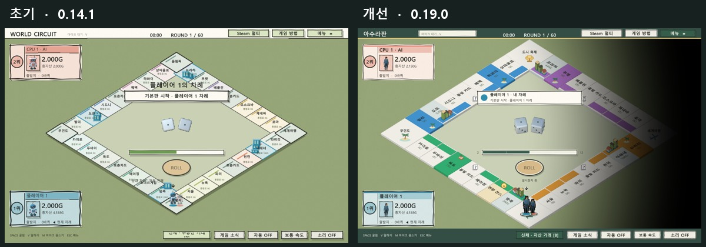

# 아수라판 | AI와 함께 만든 Unity 보드게임

통행료를 내야 하는데 현금이 부족하다. 오른눈을 팔면 400G를 받을 수 있다. 다음 주사위를 굴릴 때, 보드 오른쪽을 읽기 어려워져도 지금 파는 게 이득일까?

**[1분 플레이 영상 보기 (MP4)](https://raw.githubusercontent.com/mingsuking1002/AsuraBoard-Git/main/docs/media/asura-gameplay.mp4)** · [밸런스 실험과 샘플](https://github.com/mingsuking1002/Asura-Balance) · [게임 개발 하네스](https://github.com/mingsuking1002/GameHarness)

앞 24초는 Windows 빌드의 4인 자동 경기다. 이어지는 장면은 시야 조건을 고정한 Unity 검증 캡처로, 매각 전·후와 복구 상태를 비교한다.

## 오른눈 하나의 값

초기 버전을 플레이했을 때 한쪽 눈을 파는 선택이 보드 전체를 읽는 데 부담을 줬다. 어느 쪽 눈을 팔았는지 화면에서 바로 알아보고, 남은 시야로 다음 수를 정할 수 있도록 효과를 바꿨다.

- **한쪽 눈**을 팔면 해당 방향으로 갈수록 어두워진다. 현금과 턴 정보는 계속 읽을 수 있다.
- **양쪽 눈**을 팔면 말 주변에 시야가 남는다. 말을 따라 시야가 움직여 바로 옆 타일은 볼 수 있다.
- 오른눈의 기본 복구가는 **600G**다. 지금 400G를 마련하는 선택이 이후의 지출로 이어진다.

같은 조건에서 방향별 밝기, 이동 중 시야 중심, 복구 후 화면, 다른 플레이어 화면을 확인한다. [경제 규칙](ModooMarbleUnity/Assets/Marble/Core/GameBodyEconomy.cs) · [Unity 시야 검사](ModooMarbleUnity/Assets/Marble/Runtime/MarbleVisionRuntimeCheck.cs)

## 게임을 만들고 검증하는 방법

| 구성 | 내용 |
|---|---|
| [게임 엔진](ModooMarbleUnity/Assets/Marble/Core) | 결정적 턴 처리, 이동, 경제, 체력·무인도, 리플레이 |
| [밸런스 시뮬레이터](ModooMarbleUnity/Tools/Balance/README.md) | 4인 AI 배치, 효과별 로그, 같은 시드의 대응 비교 |
| [개발 하네스](GameHarness/README.md) | 기능별 영향 범위, 데이터·저장 호환·빌드 검증, 위키 기록 |
| [유지보수 지도](ModooMarbleUnity/Documentation/wiki/maintenance.md) | 기능별 진입 파일, 검사 명령, 인수인계 |

## 밸런스 실험 실행

Python 3.10 이상과 Unity 6000.3.9f1의 Editor 설치가 필요하다.

~~~powershell
cd ModooMarbleUnity
python Tools/Balance/run.py --games 200 --seed 4200
~~~

Validation/Balance/dashboard.html을 브라우저에서 열면 자유 선택 200판과 대응 비교 120판을 탐색할 수 있다. 경기별 로그는 matches.jsonl에 저장된다. 대시보드에서 확인한 시드·맵·노이즈·좌석 회전·지급 값으로 같은 판을 다시 실행할 수 있다.

[16판 대시보드 샘플](docs/balance-demo.html)을 다운로드하면 설치 없이 브라우저에서 탐색할 수 있다. 샘플은 UI 확인용이며 밸런스 판단에는 더 큰 표본이 필요하다.

## 게임 실행과 검증

Unity Hub에서 ModooMarbleUnity를 열고 Assets/Scenes/Classic.unity를 실행한다. 다운로드한 모델과 텍스처는 사용 권한이 있는 원본에서 Assets/Marble/Resources/Downloaded 아래에 복원한다. Unity의 Build → Validate and build에서 Windows 실행 파일을 만든다.

공통 하네스의 원본은 [GameHarness 저장소](https://github.com/mingsuking1002/GameHarness)에 있다. 소스 검사에는 Unity 설치 경로와 로컬 컴파일 캐시 경로가 필요하다. 공용 HTML 위키 재생성에는 별도 Game-Analysis-Wiki-OpenSource 프로젝트가 필요하다.
